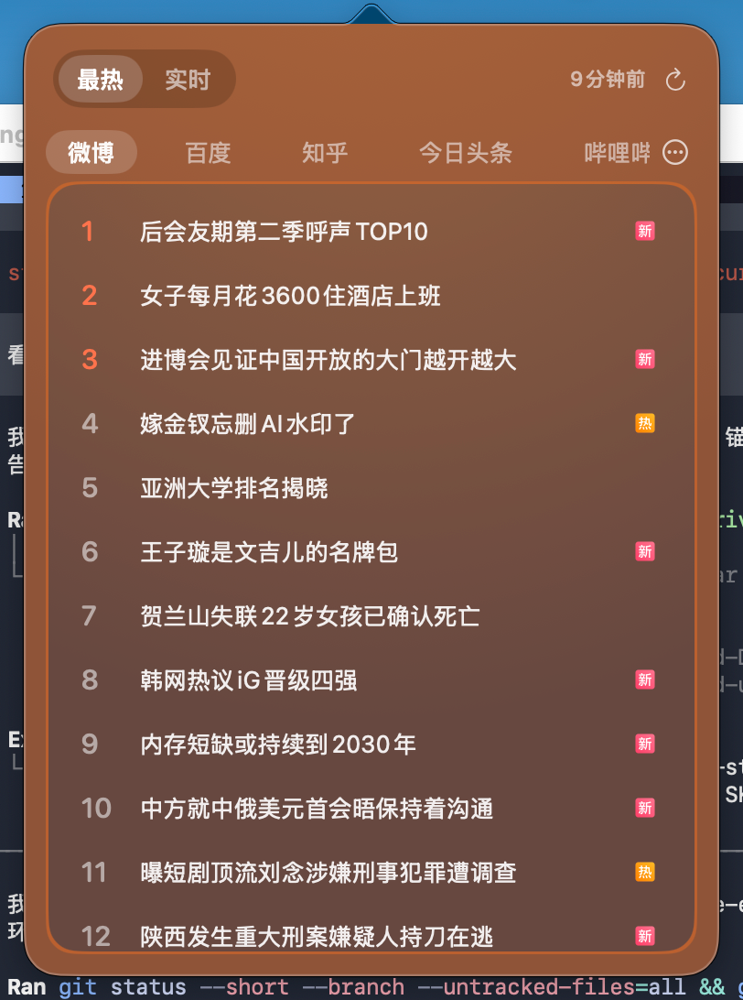
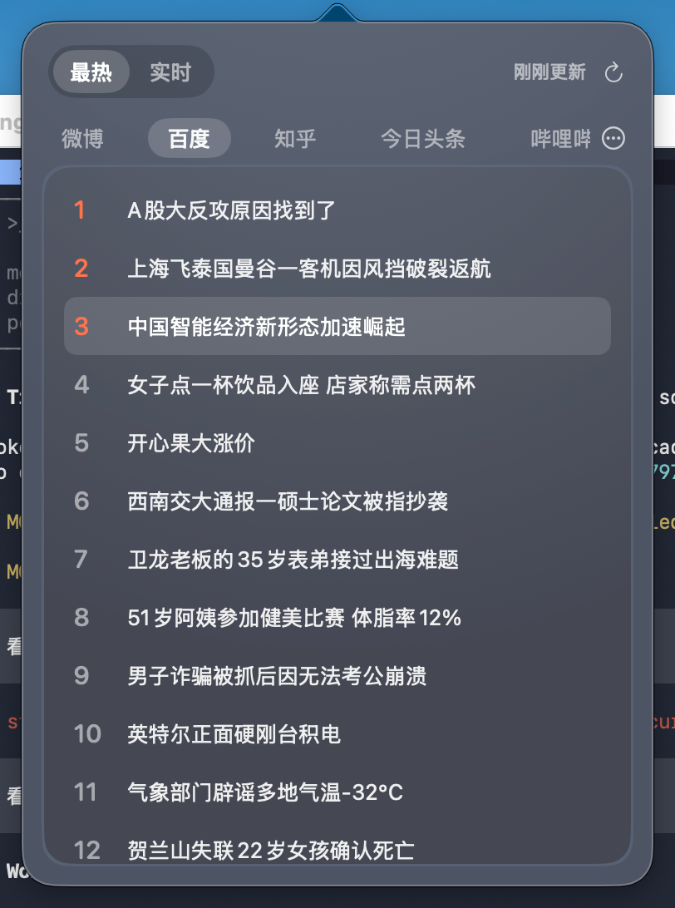
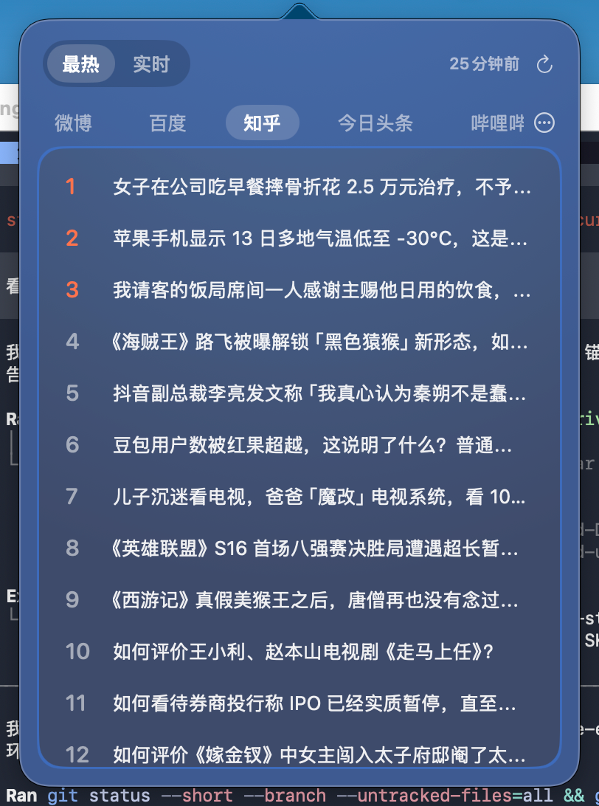

# 小咕（Oriel）

小咕是一款 macOS 菜单栏生活与效率工具，把日历、生活提醒、热搜资讯、Finder 右键工作流和桌面伙伴放到随手可用的地方。

[小咕项目](https://github.com/LiJingBiao/xiaogu) · [网站维护说明](网站说明.md)

本仓库是小咕的产品介绍网站，包含功能说明、实际界面截图和可分类、放大的截图图集。应用项目请访问上方的小咕项目链接。

## 主要功能

- 日历与天气：公历、农历、节气、宜忌、日程、节日倒数和天气预报。
- 生活提醒：喝水、打卡、吃药、活动等日常提醒，支持间隔提醒和稍后提醒。
- 热搜资讯：聚合微博、百度、知乎、今日头条、哔哩哔哩等来源，支持「最热」「实时」视图、来源筛选与排序、手动或后台刷新，以及可选的更新通知。
- Finder 右键：复制路径、新建文件、快捷启动、应用打开和 LocalSend 发送；可自定义脚本、快捷键、参数、分组及目录范围。
- 效率工具：截图与录屏、二维码、JSON 格式化、文本对比、图片压缩和字体预览等。
- 桌面伙伴：可点击、摸头、拖动的机器人，可联动 AI 任务状态；另有可调数量的桌面昆虫。
- 个性化界面：多种日历主题和桌面组件；热搜面板可跟随来源变色或使用统一深色背景。

## 热搜界面

从菜单栏打开热搜面板，在不同平台间切换，浏览排行或实时资讯。可按自己的阅读习惯调整来源、刷新间隔、更新通知和应用内网页暗黑模式。

| 微博 | 百度 | 知乎 |
| --- | --- | --- |
|  |  |  |

以上三张为用户提供的实际界面截图，榜单内容仅代表截图采集时的状态。

## 本地预览

网站使用原生 HTML、CSS 和 JavaScript，无需安装依赖或构建。在仓库根目录运行：

```sh
python3 -m http.server 4173
```

打开 <http://localhost:4173>，即可预览导航、功能介绍、截图分类与图片放大效果。

## 仓库结构

- `index.html`：首页、功能介绍、热搜展示和项目链接。
- `styles.css`：页面样式、响应式布局及减少动态效果适配。
- `script.js`：导航、截图分类与图片放大交互。
- `截图清单.js`：79 张展示图片的分类、说明、路径和尺寸。
- `截图/压缩后图片/`：随网站发布的截图与应用图标。
- [网站说明.md](网站说明.md)：截图来源、素材维护与 GitHub Pages 发布说明。

## GitHub Pages

网站仓库为 [xiaogu.github.io](https://github.com/LiJingBiao/xiaogu.github.io)。使用分支发布时，选择 `main` 分支和根目录 `/ (root)`；页面中的 GitHub 按钮指向 [小咕应用项目](https://github.com/LiJingBiao/xiaogu)。
